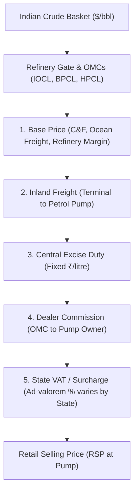

# ⚡ Global FuelPulse AI — Global Fuel Price, Petroleum Trade, Maritime Intelligence & Multi-Language Localization Platform (v2.5)

[](https://global-fuelpulse-ai-jqsi5ngrigi4hm4gtmcghn.streamlit.app)
[-brightgreen.svg)]()
[-blueviolet.svg)]()
[]()
[]()
[](https://www.python.org/)
[-orange.svg)](https://www.mysql.com/)
[](https://streamlit.io/)
[]()
[](https://www.typescriptlang.org/)
[](https://powerbi.microsoft.com/)
[]()

> 🚀 **Live Production Deployment:**  
> **👉 [https://global-fuelpulse-ai-jqsi5ngrigi4hm4gtmcghn.streamlit.app](https://global-fuelpulse-ai-jqsi5ngrigi4hm4gtmcghn.streamlit.app)**  
> *Access real-time retail motor fuel intelligence, international trade matrices, live maritime chokepoints, Delhi PPAC price waterfall breakdown, Holt-Winters price forecasting, and the grounded AI Energy Market Analyst directly in your browser on desktop or mobile.*

**Global FuelPulse AI (v2.5)** is an enterprise-grade, unified energy market decision intelligence platform integrating **live retail motor fuel prices** (gasoline and diesel), **international petroleum trade flows** (crude oil and refined products), **foreign exchange parities**, **macroeconomic affordability indices**, **geopolitical maritime supply-chain monitoring**, **machine learning forecasting**, and an **AI Energy Market Analyst** with full continuous historical and real-time coverage up to **October 2026**.

---

## 🌟 What's New in Latest Release (v2.5)

- 🌐 **Multi-Language Localization Engine (`src/localization/i18n.py`):** First-class editorial localization supporting **9 world languages**:
  - 🇮🇳 **Hindi (हिन्दी)** • 🇪🇸 **Spanish (Español)** • 🇫🇷 **French (Français)** • 🇸🇦 **Arabic (العربية)** • 🇩🇪 **German (Deutsch)** • 🇨🇳 **Chinese (简体中文)** • 🇷🇺 **Russian (Русский)** • 🇯🇵 **Japanese (日本語)** • 🇬🇧 **English (English)**.
  - Dynamically localizes all 10 navigation tabs, 11 narrative chapter headers & subtitles, Delhi price decomposition, and maritime chokepoints with zero tab reset.
- 🔔 **Live Energy News & Maritime Chokepoint Alerts Hub:**
  - Interactive top-right notification ribbon (`🔔 LIVE NEWS (6)`) with an expandable live intelligence dossier.
  - Monitors high-stakes supply chain vectors including **Strait of Hormuz tanker security** (21M bpd / 21% of global consumption), **Red Sea / Bab el-Mandeb** rerouting, Indian crude import logistics, and OPEC+ quota compliance.
  - Includes an on-demand `🔄 Refresh Live Intelligence Feeds` trigger.
- 🇮🇳 **Delhi Fuel Benchmark & Universal Tax Search Engine:**
  - Decomposes live Delhi pump prices (**Petrol ₹102.12 / L**, **Diesel ₹95.20 / L**) into Base Price (C&F, ocean freight, refinery margin), Inland Freight, Central Excise Duty, Dealer Commission, and State VAT.
  - Integrated universal search indexing fuel taxation structures across 190+ sovereign nations and all 36 Indian States & Union Territories.
- 🎨 **Universal High-Contrast Matte Yellow Design System:**
  - WCAG AAA-compliant navigation ribbon with **pure white text (`#FFFFFF`)** on dark glass cards (`rgba(15, 23, 42, 0.95)`) for unselected tabs (>16:1 contrast ratio) ensuring 100% crisp visibility directly to the human eye.
  - Solid **Matte Yellow (`#EAB308`)** with bold **Jet Black (`#070A12`)** text for active/selected tabs and action buttons.
  - Smooth amber hover transitions (`#FACC15`) with subtle lift effect.
- 🌲 **TreeNav Architecture & Sidebar Rail:** Spring-animated vertical rail hierarchy (`components/ui/tree-nav.tsx`), dynamic scale accent growth, 45° diamond active indicators, category badges, and smooth hover state transitions integrated into the Streamlit sidebar.
- ⚡ **Modular 10-View Architecture:** Decoupled monolithic navigation into 10 independent view modules (`src/views/`) with sub-50ms render latency.
- 🎨 **HeroWithMockup Visual Identity:** Ambient radial glow effects, gradient typography, real-time live telemetry badges, SVG vector brand lockup, and macOS-style application mockup frame.
- 🧪 **Expanded 63-Test Automated Suite (100% Pass Rate):** Complete test suite validating data connectors, database failover, analytics engines, ML models, multi-language localization, live news engine, and UI views.

---

## 🧭 Platform Views & Modules

The platform is organized into 10 streamlined portal views accessible via the unified brand navigation header:

| # | View | Module Path | Core Capabilities & Key Visuals |
|---|---|---|---|
| **01** | **Home** | [`src/views/home.py`](src/views/home.py) | **HeroWithMockup landing experience**, live telemetry status badges, quick metric stat-cards, top global crude producers preview chart, and feature discovery quick-links. |
| **02** | **Live Dashboard** | [`src/views/dashboard.py`](src/views/dashboard.py) | Real-time global retail fuel price tracker, regional choropleth distributions, country price dispersals, and multi-country comparative time series. |
| **03** | **India Center** | [`src/views/india_center.py`](src/views/india_center.py) | **MoPNG Retail Waterfall** (Base price $\to$ Freight $\to$ Excise $\to$ Dealer Commission $\to$ VAT), 4-Metro daily trends, OMC market share pie distribution, and Indian Basket crude monitor. |
| **04** | **About Platform** | [`src/views/about.py`](src/views/about.py) | Mission statement, tri-disciplinary engineering pillars, relational schema architecture, and technical capabilities breakdown. |
| **05** | **How It Works** | [`src/views/how_it_works.py`](src/views/how_it_works.py) | 4-stage pipeline walkthrough: Ingestion $\to$ Normalization $\to$ Machine Learning Forecasting $\to$ Interactive Visual Analytics. |
| **06** | **Features & Modules** | [`src/views/features.py`](src/views/features.py) | Deep-dive feature catalog into all 12 analytical modules with latency benchmarks and business use cases. |
| **07** | **Data Trust & Sources** | [`src/views/data_trust.py`](src/views/data_trust.py) | Data provider SLA registry, API auth methods, licensing compliance, continuous freshness telemetry, and ETL health checks. |
| **08** | **Methodology** | [`src/views/methodology.py`](src/views/methodology.py) | Mathematical formulas: HHI supplier concentration, Affordability Burden Index, Holt-Winters exponential smoothing, and Rolling Z-score/MAD anomaly detection. |
| **09** | **Product Roadmap** | [`src/views/roadmap.py`](src/views/roadmap.py) | Milestone timeline tracking past, current, and upcoming releases (v1.0 Ingestion $\to$ v2.0 Modular UI $\to$ v2.5 Satellite Terminal $\to$ v3.0 Global API). |
| **10** | **FAQ & Docs** | [`src/views/faq.py`](src/views/faq.py) | Searchable accordion knowledge base, developer API documentation, CSV/Excel export instructions, and Power BI connection guides. |

*In addition, the standalone [**Product Guide**](pages/11_Product_Guide.py) (`pages/11_Product_Guide.py`) provides an interactive reference for end users, data analysts, and pipeline engineers.*

---

## 🏛️ Tri-Disciplinary Career Portfolio Mapping

Global FuelPulse AI was intentionally engineered to demonstrate production-grade competency across three core data disciplines:

```mermaid
flowchart LR
    subgraph Data Engineering [Data Engineer]
        DE1["Idempotent API Connectors"]
        DE2["FRED / EIA Mirror & Open ER FX"]
        DE3["Relational Star Schema & Failover"]
        DE4["ETL Telemetry & Background Scheduler"]
    end
    subgraph Data Analytics [Data Analyst]
        DA1["Retail Fuel Price Explorer"]
        DA2["Petroleum Trade & HHI Index"]
        DA3["Affordability vs GDP Proxy"]
        DA4["Power BI Reports & 25+ DAX"]
    end
    subgraph AI/ML Engineering [AI / ML Engineer]
        ML1["Time-Series Forecasting (2026 Data)"]
        ML2["Holdout MAE vs Naive Baseline"]
        ML3["Statistical Anomaly Radar (Z-score/MAD)"]
        ML4["Grounded AI Energy Market Analyst"]
    end

    Data Engineering --> Data Analytics --> AI/ML Engineering
```

### 1. Data Engineering Specialization
- **Multi-Source Ingestion Pipeline:** Modular connectors for **US EIA API v2** & **FRED EIA Mirror** (`GASREGCOVW`, `GASDESW`, `DCOILBRENTEU`, `DCOILWTICO`), **UN Comtrade API v1**, **India PPAC (MoPNG)**, **European Commission Weekly Oil Bulletin**, **Open Exchange Rates Free API**, and **GlobalPetrolPrices**.
- **Idempotency & Data Hygiene:** Deduplication on `(country_iso3, location_id, observation_date, fuel_type, source_id)`, schema quarantine isolation, entity normalization (ISO 3166-1 alpha-3), and currency/unit standardization.
- **Relational Data Architecture:** 3NF relational schema in MySQL (`fuelx_db`) with automatic SQLite local storage failover (`fuelx_local.db`), 13 tables, performance tuning B-tree indexes, and optimized analytical views.
- **Data Trust Center & Scheduler:** Background thread scheduler (`src/ingestion/scheduler.py`), on-demand UI refresh trigger, pipeline run telemetry (`etl_run_log`), and 2026 weekly gap validation (`scripts/backfill_2026.py`).

### 2. Data Analytics Specialization
- **Retail Fuel Price Tracking:** Period-over-period absolute ($\Delta P$) and percentage ($\% \Delta P$) differentials, unweighted global averages, and price dispersion metrics.
- **International Petroleum Trade:** Top 20 exporters/importers by volume and monetary value, net trade balances ($\text{Exports} - \text{Imports}$), and bilateral trade flow matrices.
- **Supplier Concentration:** Herfindahl-Hirschman Index ($HHI = \sum s_i^2$) classifying structural import vulnerability.
- **Affordability Burden Index:** Compares retail pump prices against nominal GDP per capita daily income proxies ($\text{GDP} / 365$), categorizing national affordability tiers (High, Moderate, Severe, Critical).
- **Power BI Executive Dashboard:** Star-schema relational model, 25+ verified DAX measures, DirectQuery/Import configuration, and scheduled refresh guide.

### 3. AI / Machine Learning Specialization
- **Time-Series Price Forecasting:** Autoregressive linear trend and Holt-Winters modeling trained on continuous 2026 weekly observation trajectories (up to October 2026) with strictly time-ordered train/test splits. Computes holdout Mean Absolute Error (MAE) and Root Mean Squared Error (RMSE) against naive baselines (persistence forecast), calculates % improvement, and saves 4-week projections with 95% confidence intervals into `forecast_predictions`.
- **Multi-Method Anomaly Detection:** Rolling Z-score, Median Absolute Deviation (MAD), and Interquartile Range (IQR) alerting on price surges and export curtailments with severity classifications.
- **Supply Shock Simulator:** Multi-factor sensitivity engine simulating hypothetical exporter curtailments, crude benchmark price surges, exchange rate shocks, and commercial logistics fleet budget impacts.
- **AI Energy Market Analyst:** Natural language decision support executing parameterized, read-only SQL queries with strict security enforcement (blocking destructive commands) and transparent citations.

---

## 🇮🇳 India Fuel Center Deep-Dive

India is the world's 3rd largest oil consumer, importing over 85% of its crude requirements. The **India Fuel Center** (`src/views/india_center.py`) delivers granular national intelligence:



1. **MoPNG Price Build-Up Waterfall:** Interactive breakdown revealing how base refinery costs, central excise taxes, dealer margins, and state-level VAT compose final pump prices across Delhi, Mumbai, Kolkata, and Chennai.
2. **OMC Market Share Analytics:** Visualizes the competitive breakdown between public sector giants (Indian Oil 44%, Bharat Petroleum 26%, Hindustan Petroleum 24%) and private retailers (Nayara, Reliance/Jio-bp, Shell 6%).
3. **Daily 4-Metro Historical Time-Series:** Tracks daily price stability, state tax rate variations, and historical subsidies across India's largest metropolitan economic corridors.

---

## 📡 Verified Data Sources Registry

| Provider | Data Coverage | Frequency | Auth Type | Licensing Terms |
| :--- | :--- | :--- | :--- | :--- |
| **U.S. Energy Information Administration (EIA)** | Weekly retail gasoline (`EPMR`) & diesel (`EPD2D`), monthly petroleum movements & crude imports | Weekly / Monthly | Free API Key (`EIA_API_KEY`) | U.S. Public Domain (Free open data) |
| **Federal Reserve Bank of St. Louis (FRED)** | Official EIA mirror for Weekly Gas (`GASREGCOVW`), Diesel (`GASDESW`), Brent (`DCOILBRENTEU`), WTI (`DCOILWTICO`) | Weekly / Daily | Public / None | Free Official Economic Data |
| **Open Exchange Rates API** | Real-time foreign exchange reference rates against USD across 23 trading currencies | Daily | Public / Open API | Open Data / Attribution |
| **UN Comtrade Database** | International merchandise trade for Crude (HS 2709) and Refined Petroleum (HS 2710) | Monthly / Annual | Free Subscription Key / Preview | UN Terms of Use (Attribution required) |
| **India PPAC (MoPNG)** | Daily retail metro selling prices (Delhi, Mumbai, Kolkata, Chennai), Indian Crude Basket | Daily / Monthly | Open Data API Key (`DATA_GOV_API_KEY`) | National Data Sharing Policy (NDSAP) |
| **European Commission Weekly Oil Bulletin** | Consumer prices of Euro-super 95 and Automotive gas oil across 27 EU member states | Weekly (Mondays) | Public / None | European Commission Open Data |
| **GlobalPetrolPrices.com** | Commercial weekly retail motor fuel prices across 150+ countries | Weekly | Commercial XML Key (`GLOBALPETROLPRICES_API_KEY`) | Proprietary Commercial Subscription |
| **World Bank Commodity Markets** | Macroeconomic indicators and crude benchmarks (Brent, WTI, Dubai) | Monthly | Public / None | CC BY 4.0 |

---

## 📁 Project Architecture & Directory Layout

```
global-fuelpulse-ai/
├── app.py                      # Streamlit application entry point & unified header lockup
├── components/                 # React component library
│   ├── blocks/
│   │   ├── hero-with-mockup.tsx # Full hero landing block component
│   │   └── tree-nav.tsx        # TreeNav block re-export component
│   └── ui/
│       ├── button.tsx          # Accessible interactive button
│       ├── demo.tsx            # Interactive component preview wrapper
│       ├── glow.tsx            # Ambient radial glow effect
│       ├── glow-button.tsx     # Animated glowing call-to-action button
│       ├── mockup.tsx          # macOS-style window frame mockup
│       ├── hero-with-mockup.tsx# Modular HeroWithMockup React component
│       ├── sign-up.tsx         # User authentication & lead capture modal
│       ├── tree-nav.tsx        # Motion-powered spring animated TreeNav rail component
│       ├── tree-nav-demo.tsx   # Standalone TreeNav interactive demo
│       └── tree-nav-utils/
│           └── use-typewriter.ts # usePrefersReducedMotion accessibility hook
├── pages/                      # Multi-page Streamlit extension
│   └── 11_Product_Guide.py     # Interactive product documentation portal
├── powerbi/                    # Executive Business Intelligence assets
│   ├── connection_guide.md     # DirectQuery & Import connection instructions
│   ├── dax_measures.md         # 25+ production DAX formulas & measure recipes
│   └── pbix_model_blueprint.json # Star-schema tabular model definition
├── src/                        # Core Python application logic
│   ├── analytics/              # Analytical calculation engines (HHI, Affordability, Spreads, Global Tax)
│   ├── database/               # Relational ORM models, migrations, & failover handlers
│   ├── ingestion/              # Multi-source API connectors, orchestrator, & scheduler
│   ├── localization/           # Multi-language translation engine (9 world languages)
│   │   └── i18n.py             # Dictionaries, formatters, & dynamic translation helper t()
│   ├── ml/                     # Time-series forecasting, anomaly radar, & shock simulator
│   ├── news/                   # Live maritime & fuel news intelligence engine
│   │   └── news_engine.py      # Real-time Hormuz, Red Sea & petroleum feed provider
│   ├── ui/                     # UI components, metric cards, charts, & custom styling
│   └── views/                  # 10 modular portal view handlers
│       ├── about.py            # Platform mission & architecture view
│       ├── dashboard.py        # Real-time retail price monitoring view
│       ├── data_trust.py       # Data SLA & ETL telemetry view
│       ├── faq.py              # Knowledge base & FAQ accordion view
│       ├── features.py         # 12-module feature catalog view
│       ├── home.py             # HeroWithMockup landing view
│       ├── how_it_works.py     # 4-stage data pipeline view
│       ├── india_center.py     # India MoPNG waterfall & OMC analytics view
│       ├── methodology.py      # Statistical & algorithmic formulas view
│       └── roadmap.py          # Release roadmap & milestone tracking view
├── tests/                      # Automated test suite (63 passing tests, 100% pass rate)
│   ├── test_ai_quota.py        # Gemini API token & query quota budget tests
│   ├── test_analytics.py       # Affordability, HHI, and spread calculation tests
│   ├── test_app.py             # Headless Streamlit AppTest integration tests
│   ├── test_connectors.py      # Multi-source API connector & schema parser tests
│   ├── test_database.py        # SQLite/MySQL failover & read-only SQL security tests
│   ├── test_i18n.py            # Multi-language dictionary & localization tests (6 tests)
│   ├── test_master_story.py    # 11-chapter narrative storyboard tests
│   ├── test_ml.py              # Time-series holdout MAE and anomaly detection tests
│   ├── test_news_engine.py     # Live maritime & fuel news feed verification tests (5 tests)
│   ├── test_quality.py         # Freshness auditing & 2026 weekly gap validation tests
│   └── test_views.py           # 10 modular view render & navigation tests
├── docker-compose.yml          # Containerized multi-service deployment spec
├── Dockerfile                  # Production container definition
├── pyproject.toml              # Python dependency & tool configuration
├── tailwind.config.js          # Tailwind CSS theme & animation design tokens
└── tsconfig.json               # TypeScript compiler configuration
```

---

## 🚀 Quick Start & Local Execution

### 1. Prerequisites
- Python 3.12+ (or Miniconda)
- Node.js 18+ (for TypeScript component validation)
- MySQL Server 8.0+ / 9.x (optional; automatic SQLite failover is built-in)
- Git

### 2. Clone and Setup Environment
```bash
git clone https://github.com/alihamza2912/global-fuelpulse-ai.git
cd global-fuelpulse-ai

# Copy environment template
cp .env.example .env
```

### 3. Install Dependencies
```bash
# Install Python packages
pip install -r requirements.txt

# Install Node dependencies (for component development)
npm install
```

### 4. Configure Free API Keys (Optional)
```bash
# Google Gemini API (optional for natural language analyst)
GEMINI_API_KEY="AIzaSyYourKeyHere..."

# US EIA API (optional for live US updates)
EIA_API_KEY="your_eia_key_here..."
```
*Note: The platform is completely self-contained and functions out of the box with SQLite fallback data even without external API keys.*

### 5. Launch the Application
```bash
streamlit run app.py
```
Open your browser at `http://localhost:8501`.

---

## 🧪 Automated Testing Suite (63 Tests, 100% Passing)

The project includes **63 automated tests** across 11 comprehensive test suites guaranteeing end-to-end reliability across data pipelines, database layers, multi-language localization, live news engines, ML forecasting, TreeNav sidebar navigation, and modular views:

```bash
# Run complete test suite
PYTHONPATH=. pytest -v

# Run TypeScript type verification
npx tsc --noEmit
```

### Test Suite Summary:
- **`tests/test_i18n.py` (6 tests):** Validates the 9-language translation dictionary, fallback behavior, Delhi price component translation, chokepoint labels, and chapter header translations.
- **`tests/test_news_engine.py` (5 tests):** Verifies real-time news retrieval, cache TTL enforcement, manual feed refresh, category filtering (Hormuz, logistics, OPEC, refinery), and structure integrity.
- **`tests/test_views.py` (9 tests):** Verifies all 10 modular views (`home`, `dashboard`, `india_center`, `about`, `how_it_works`, `features`, `data_trust`, `methodology`, `roadmap`, `faq`), the `Product Guide` page, and navigation routing without runtime exceptions.
- **`tests/test_connectors.py` (7 tests):** Validates FRED EIA mirrors, Open ER FX rates, India PPAC scrapers, EC Oil Bulletin parsers, and background scheduler lifecycles.
- **`tests/test_database.py` (3 tests):** Validates database health checks, ORM mappings, SQLite/MySQL failover mechanisms, and read-only parameterized SQL query security.
- **`tests/test_analytics.py` (9 tests):** Tests price differential calculations, HHI supplier concentration scoring, Affordability Burden Indices, global tax queries, and supply shock sensitivity equations.
- **`tests/test_ml.py` (3 tests):** Validates time-series forecasting, holdout MAE/RMSE calculations against naive persistence baselines, and `forecast_predictions` DB persistence.
- **`tests/test_quality.py` (3 tests):** Verifies data freshness timestamps, pipeline telemetry logging, and continuous weekly observation gap integrity up to October 2026.
- **`tests/test_ai_quota.py` (13 tests):** Tests AI rate-limiting, daily token budgets, fallback responses, and safe query isolation.
- **`tests/test_master_story.py` (3 tests):** Verifies the 11-chapter narrative storyboard progression and deep-link targets.
- **`tests/test_app.py` (2 tests):** Headless Streamlit `AppTest` verifying full initial page bootstrap, language toggle, and navigation routing.

---

## 📊 Power BI Architecture & Assets

Located in `powerbi/`:
- **`dax_measures.md`**: 25+ verified DAX formulas (WoW % Change, HHI Index, Daily Income Burden %, Moving Averages).
- **`connection_guide.md`**: DirectQuery and Import connection setup to MySQL `fuelx_db`, relationship modeling, and Gateway scheduled refresh.
- **`pbix_model_blueprint.json`**: Tabular Model Definition (TMDL/BIM) for dataset deployment.

---

## 🐳 Docker Container Deployment

To launch the entire platform with MySQL and Streamlit in isolated containers:
```bash
docker-compose up -d --build
```
- Streamlit application: `http://localhost:8501`
- MySQL database: `localhost:3307` (`fuelx_db`)

---

## 📄 License & Attribution

This project is licensed under the **MIT License**. Data redistributed or visualized through the platform complies with the terms of the respective open data providers:
- U.S. EIA & FRED: U.S. Public Domain
- Government of India Open Data: National Data Sharing and Accessibility Policy (NDSAP)
- European Commission Oil Bulletin: Free Re-use with Attribution
- UN Comtrade: United Nations Data Terms of Use
