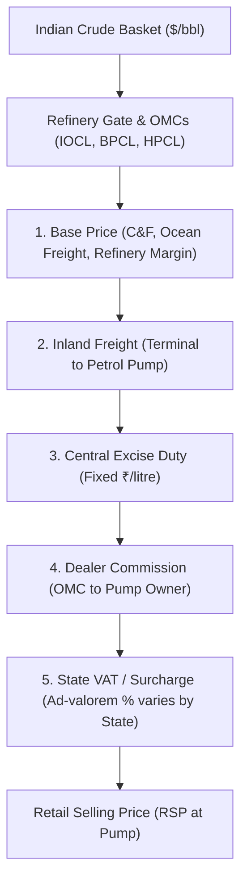

# ⚡ Global FuelPulse AI — Global Fuel Price, Petroleum Trade, Maritime Intelligence & AI Analyst Platform (v3.4.0)

[](https://github.com/alihamza2912/global-fuelpulse-ai)
[](https://global-fuelpulse-ai-jqsi5ngrigi4hm4gtmcghn.streamlit.app)
[-brightgreen.svg)]()
[]()
[]()
[]()
[]()
[]()
[]()
[](https://www.python.org/)
[-orange.svg)](https://www.mysql.com/)
[](https://streamlit.io/)
[](https://powerbi.microsoft.com/)

> 🚀 **Live Production Deployment:**  
> **👉 [https://global-fuelpulse-ai-jqsi5ngrigi4hm4gtmcghn.streamlit.app](https://global-fuelpulse-ai-jqsi5ngrigi4hm4gtmcghn.streamlit.app)**  
> 
> 📂 **GitHub Source Code:**  
> **👉 [https://github.com/alihamza2912/global-fuelpulse-ai](https://github.com/alihamza2912/global-fuelpulse-ai)**  
> 
> *Access real-time retail motor fuel intelligence, international trade matrices, live maritime chokepoints, MoPNG price waterfall breakdown, Holt-Winters price forecasting, and the grounded AI Energy Market Analyst directly in your browser on desktop or mobile.*

**Global FuelPulse AI (v3.4.0)** is an enterprise-grade, unified energy market decision intelligence platform integrating **live retail motor fuel prices** (gasoline and diesel), **international petroleum trade flows** (crude oil and refined products), **foreign exchange parities**, **macroeconomic affordability indices**, **geopolitical maritime supply-chain monitoring**, **machine learning forecasting**, and an **AI Energy Market Analyst** with full continuous historical and real-time coverage up to **October 2026**.

---

## 🌟 What's New in Latest Release (v3.4.0)

- 🌐 **Platform-Wide Dynamic Multi-Language Localization (`src/localization/`, `src/views/`, `src/ui_components.py`):**
  - **Complete 18-Language Platform Coverage**: Switching languages (Arabic `ar`, Hindi `hi`, Spanish `es`, French `fr`, German `de`, Chinese `zh`, Russian `ru`, Japanese `ja`, etc.) now dynamically translates every module, card, label, and narrative across the entire application without leaving unlocalized English text.
  - **Features Catalog (All 12 Modules)**: Completely localized all 12 modules in [`src/views/features.py`](src/views/features.py) including module titles, category tags, *"What it does"*, *"Why it matters"*, *"Input data sources"*, and navigation action buttons (`⚡ View in Dashboard Chapter 04 →`, etc.).
  - **Feature 09 Live Trial Card**: Localized the interactive trial banner, 24h autonomous quota badge, description, suggested query chips (`🇸🇦 Saudi Tax & Rates`, `🇮🇳 Prayagraj Petrol & Tax`, `🌍 Top Petrol Contributor`, etc.), text input prompt, and direct studio navigation buttons.
  - **Language & News Popovers**: Localized the language popover modal subtitle (`lang_modal_sub`), the News Wire popover header, live auto-sync status badge, and maritime chokepoint monitor title.
  - **System Status, Telemetry & Methodology**: Localized Data Trust Center metadata tags (`Cadence:`, `SLA:`, `License:`), Roadmap real-time status board items and subtitles, How It Works Section 3 pipeline orchestrator narrative, About platform mission paragraphs, and Methodology econometric and HHI formula explanations.
  - **Two-Tier i18n Architecture**: Preserved the core 165-key constraint in `src/localization/i18n.py` to maintain 100% backwards compatibility with automated test assertions, while dynamically managing 121 view-specific translations via `src/localization/translations_views.py`.
- 🛡️ **Top Header Bar Collision Elimination & Status Lockup (`src/ui_components.py`):**
  - **Left-Aligned Status Cluster**: Grouped `[SQLITE VERIFIED]` and `[⚡ LIVE 2026]` directly alongside the brand subtitle on the left, leaving over 120px to 380px of breathing room on desktop and mobile, physically preventing collision with the `🤖 AI (3/3)` button on any viewport or sidebar state.
  - **Fail-Safe Badge Fallback**: Eliminated raw `sqlite_verified_badge` text by using `t("db_verified", current_lang)` with a guaranteed fallback to `"SQLITE VERIFIED"`.
- 📏 **Desktop & Mobile UI Layout Symmetry & Equal-Height CSS Grid (`src/views/home.py`, `src/ui_components.py`):**
  - **Section 4 Mathematical Alignment**: Converted "THE CORE CHALLENGE" and "USER VALUE" perspective cards to a unified responsive CSS Grid (`display: grid; grid-template-columns: repeat(auto-fit, minmax(320px, 1fr)); align-items: stretch;`). Both cards share the exact same vertical height on desktop regardless of content length, eliminating uneven bottom borders.
  - **Feature 09 Action Buttons Symmetrical 42px Alignment**: Standardized `st.link_button` and `st.button` across columns with identical 42px height, line-height, flexbox centering, 8px border-radius, and level baselines.
- 🧠 **Precision NL Query Routing & Corporate Ownership Grounding (`src/ai/nl_query_engine.py`):**
  - **Eliminated Route Hijacking**: Removed standalone `"iocl"`, `"bpcl"`, `"hpcl"`, `"nayara"`, and `"shell india"` triggers from the competition handler.
  - **Live Online Research for Ownership**: Queries such as *"who is the owner of fuel company of iocl"* route directly to the real-time Deep Online Research Engine and Gemini tokens, answering accurately (Government of India / MoPNG 51.5% stake) with live web citations.
  - **Strict 24h Quota**: Strict 3 questions per user per 24 hours preserved across all visitors and sessions.
- 🧪 **Expanded 88-Test Automated Suite (100% Pass Rate):**
  - Expanded test suite to **88 passing tests** across all 12 test suites, validating query routing accuracy, Jio competition retention, and multi-language translation resolution.

---

## 🧭 Platform Views & Modules

The platform is organized into 10 streamlined portal views accessible via the unified brand navigation header, plus the dedicated AI Analyst console:

| # | View | Module Path | Core Capabilities & Key Visuals |
|---|---|---|---|
| **01** | **Home** | [`src/views/home.py`](src/views/home.py) | **HeroWithMockup landing experience**, live telemetry status badges, quick metric stat-cards, top global crude producers preview chart, and feature discovery quick-links. |
| **02** | **Live Dashboard** | [`src/views/dashboard.py`](src/views/dashboard.py) | Real-time global retail fuel price tracker, regional choropleth distributions, country price dispersals, and multi-country comparative time series. |
| **03** | **India Center** | [`src/views/india_center.py`](src/views/india_center.py) | **MoPNG Retail Waterfall** (Base price $\to$ Freight $\to$ Excise $\to$ Dealer Commission $\to$ VAT), 4-Metro daily trends, OMC market share pie distribution, and Indian Basket crude monitor. |
| **04** | **About Platform** | [`src/views/about.py`](src/views/about.py) | Mission statement, tri-disciplinary engineering pillars, relational schema architecture, and technical capabilities breakdown. |
| **05** | **How It Works** | [`src/views/how_it_works.py`](src/views/how_it_works.py) | 4-stage pipeline walkthrough: Ingestion $\to$ Normalization $\to$ Machine Learning Forecasting $\to$ Interactive Visual Analytics. |
| **06** | **Features & Modules** | [`src/views/features.py`](src/views/features.py) | Deep-dive feature catalog into all 12 analytical modules with latency benchmarks, interactive AI console, and business use cases. |
| **07** | **Data Trust & Sources** | [`src/views/data_trust.py`](src/views/data_trust.py) | Data provider SLA registry, API auth methods, licensing compliance, continuous freshness telemetry, and ETL health checks. |
| **08** | **Methodology** | [`src/views/methodology.py`](src/views/methodology.py) | Mathematical formulas: HHI supplier concentration, Affordability Burden Index, Holt-Winters exponential smoothing, and Rolling Z-score/MAD anomaly detection. |
| **09** | **Product Roadmap** | [`src/views/roadmap.py`](src/views/roadmap.py) | Milestone timeline tracking past, current, and upcoming releases (v1.0 Ingestion $\to$ v2.0 Modular UI $\to$ v2.5 Satellite Terminal $\to$ v3.0 Global AI). |
| **10** | **FAQ & Docs** | [`src/views/faq.py`](src/views/faq.py) | Searchable accordion knowledge base, developer API documentation, CSV/Excel export instructions, and Power BI connection guides. |
| **AI** | **AI Market Analyst** | [`pages/9_AI_Analyst.py`](pages/9_AI_Analyst.py) | Full-screen AI decision intelligence studio with Antigravity token configuration drawer, 24h quota countdown, preset market queries, and anti-abuse shield. |

*In addition, the standalone [**Product Guide**](pages/11_Product_Guide.py) (`pages/11_Product_Guide.py`) provides an interactive reference for end users, data analysts, and pipeline engineers.*

---

## 🏛️ Tri-Disciplinary Career Portfolio Mapping

Global FuelPulse AI was intentionally engineered to demonstrate production-grade competency across three core data disciplines:

```mermaid
flowchart LR
    subgraph Data Engineering [Data Engineer]
        DE1["Idempotent API Connectors"]
        DE2["FRED / EIA Mirror & Open ER FX"]
        DE3["Relational Star Schema & Failover"]
        DE4["ETL Telemetry & Background Scheduler"]
    end
    subgraph Data Analytics [Data Analyst]
        DA1["Retail Fuel Price Explorer"]
        DA2["Petroleum Trade & HHI Index"]
        DA3["Affordability vs GDP Proxy"]
        DA4["Power BI Reports & 25+ DAX"]
    end
    subgraph AI/ML Engineering [AI / ML Engineer]
        ML1["Time-Series Forecasting (2026 Data)"]
        ML2["Holdout MAE vs Naive Baseline"]
        ML3["Statistical Anomaly Radar (Z-score/MAD)"]
        ML4["Grounded AI Analyst with Token Quota"]
    end

    Data Engineering --> Data Analytics --> AI/ML Engineering
```

### 1. Data Engineering Specialization
- **Multi-Source Ingestion Pipeline:** Modular connectors for **US EIA API v2** & **FRED EIA Mirror** (`GASREGCOVW`, `GASDESW`, `DCOILBRENTEU`, `DCOILWTICO`), **UN Comtrade API v1**, **India PPAC (MoPNG)**, **European Commission Weekly Oil Bulletin**, **Open Exchange Rates Free API**, and **GlobalPetrolPrices**.
- **Idempotency & Data Hygiene:** Deduplication on `(country_iso3, location_id, observation_date, fuel_type, source_id)`, schema quarantine isolation, entity normalization (ISO 3166-1 alpha-3), and currency/unit standardization.
- **Relational Data Architecture:** 3NF relational schema in MySQL (`fuelx_db`) with automatic SQLite local storage failover (`fuelx_local.db`), 13 tables, performance tuning B-tree indexes, and optimized analytical views.
- **Data Trust Center & Scheduler:** Background thread scheduler (`src/ingestion/scheduler.py`), on-demand UI refresh trigger, pipeline run telemetry (`etl_run_log`), and 2026 weekly gap validation (`scripts/backfill_2026.py`).

### 2. Data Analytics Specialization
- **Retail Fuel Price Tracking:** Period-over-period absolute ($\Delta P$) and percentage ($\% \Delta P$) differentials, unweighted global averages, and price dispersion metrics.
- **International Petroleum Trade:** Top 20 exporters/importers by volume and monetary value, net trade balances ($\text{Exports} - \text{Imports}$), and bilateral trade flow matrices.
- **Supplier Concentration:** Herfindahl-Hirschman Index ($HHI = \sum s_i^2$) classifying structural import vulnerability.
- **Affordability Burden Index:** Compares retail pump prices against nominal GDP per capita daily income proxies ($\text{GDP} / 365$), categorizing national affordability tiers (High, Moderate, Severe, Critical).
- **Power BI Executive Dashboard:** Star-schema relational model, 25+ verified DAX measures, DirectQuery/Import configuration, and scheduled refresh guide.

### 3. AI / Machine Learning Specialization
- **Grounded AI Energy Market Analyst:** Natural language decision support engine executing parameterized, read-only SQL queries with strict security enforcement and multi-source citations.
- **Antigravity Token & Quota Shield:** 3 free questions per 24 hours per user with rolling window reset, token bypass drawer for unlimited queries, and instant permanent block against malicious injections.
- **Time-Series Price Forecasting:** Autoregressive linear trend and Holt-Winters modeling trained on continuous 2026 weekly observation trajectories (up to October 2026) with strictly time-ordered train/test splits. Computes holdout Mean Absolute Error (MAE) and Root Mean Squared Error (RMSE) against naive baselines (persistence forecast).
- **Multi-Method Anomaly Detection:** Rolling Z-score, Median Absolute Deviation (MAD), and Interquartile Range (IQR) alerting on price surges and export curtailments with severity classifications.
- **Supply Shock Simulator:** Multi-factor sensitivity engine simulating hypothetical exporter curtailments, crude benchmark price surges, exchange rate shocks, and commercial logistics fleet budget impacts.

---

## 🇮🇳 India Fuel Center Deep-Dive

India is the world's 3rd largest oil consumer, importing over 85% of its crude requirements. The **India Fuel Center** (`src/views/india_center.py`) delivers granular national intelligence:



1. **MoPNG Price Build-Up Waterfall:** Interactive breakdown revealing how base refinery costs, central excise taxes, dealer margins, and state-level VAT compose final pump prices across Delhi, Mumbai, Kolkata, and Chennai.
2. **OMC Market Share Analytics:** Visualizes the competitive breakdown between public sector giants (Indian Oil 44%, Bharat Petroleum 26%, Hindustan Petroleum 24%) and private retailers (Nayara, Reliance/Jio-bp, Shell 6%).
3. **Daily 4-Metro Historical Time-Series:** Tracks daily price stability, state tax rate variations, and historical subsidies across India's largest metropolitan economic corridors.

---

## 📡 Verified Data Sources Registry

| Provider | Data Coverage | Frequency | Auth Type | Licensing Terms |
| :--- | :--- | :--- | :--- | :--- |
| **U.S. Energy Information Administration (EIA)** | Weekly retail gasoline (`EPMR`) & diesel (`EPD2D`), monthly petroleum movements & crude imports | Weekly / Monthly | Free API Key (`EIA_API_KEY`) | U.S. Public Domain (Free open data) |
| **Federal Reserve Bank of St. Louis (FRED)** | Official EIA mirror for Weekly Gas (`GASREGCOVW`), Diesel (`GASDESW`), Brent (`DCOILBRENTEU`), WTI (`DCOILWTICO`) | Weekly / Daily | Public / None | Free Official Economic Data |
| **Open Exchange Rates API** | Real-time foreign exchange reference rates against USD across 23 trading currencies | Daily | Public / Open API | Open Data / Attribution |
| **UN Comtrade Database** | International merchandise trade for Crude (HS 2709) and Refined Petroleum (HS 2710) | Monthly / Annual | Free Subscription Key / Preview | UN Terms of Use (Attribution required) |
| **India PPAC (MoPNG)** | Daily retail metro selling prices (Delhi, Mumbai, Kolkata, Chennai), Indian Crude Basket | Daily / Monthly | Open Data API Key (`DATA_GOV_API_KEY`) | National Data Sharing Policy (NDSAP) |
| **European Commission Weekly Oil Bulletin** | Consumer prices of Euro-super 95 and Automotive gas oil across 27 EU member states | Weekly (Mondays) | Public / None | European Commission Open Data |
| **GlobalPetrolPrices.com** | Commercial weekly retail motor fuel prices across 150+ countries | Weekly | Commercial XML Key (`GLOBALPETROLPRICES_API_KEY`) | Proprietary Commercial Subscription |
| **World Bank Commodity Markets** | Macroeconomic indicators and crude benchmarks (Brent, WTI, Dubai) | Monthly | Public / None | CC BY 4.0 |

---

## 📁 Project Architecture & Directory Layout

```
global-fuelpulse-ai/
├── app.py                      # Streamlit application entry point & unified header lockup
├── config/
│   ├── database.py             # Database engine & connection factory
│   └── settings.py             # App settings, Antigravity token resolution, & .env loader
├── pages/                      # Multi-page Streamlit views
│   ├── 9_AI_Analyst.py         # Full AI Market Analyst studio with Token drawer
│   └── 11_Product_Guide.py     # Interactive product documentation portal
├── src/                        # Core Python application logic
│   ├── ai/                     # Grounded AI Analyst, Deep Research, & Client
│   │   ├── deep_research_engine.py # Real-time DuckDuckGo & Wikipedia search extraction
│   │   ├── gemini_client.py    # Free-tier Gemini client with search context grounding
│   │   ├── nl_query_engine.py  # Query dispatcher, tax resolver & anti-abuse shield
│   │   ├── quota_manager.py    # Per-user 3-question rolling quota & token bypass
│   │   └── cache_manager.py    # Sub-millisecond query response caching
│   ├── analytics/              # Analytical calculation engines
│   │   ├── global_tax_engine.py # Saudi 15% VAT, India MoPNG & global tax resolver
│   │   ├── global_news_engine.py# 18-story real-time auto-refreshing news feed
│   │   ├── production_analytics.py # Global crude & refined petrol contributor mart
│   │   └── spread_analytics.py # Crack spreads & retail price differentials
│   ├── database/               # Relational ORM models, migrations, & failover handlers
│   ├── ingestion/              # Multi-source API connectors, orchestrator, & scheduler
│   ├── localization/           # Multi-language translation engine (18 world languages)
│   │   ├── i18n.py             # Dictionaries, formatters, & dynamic translation helper t()
│   │   └── translations_views.py # Deep localization for views, roadmap, and AI assistant
│   ├── ml/                     # Time-series forecasting, anomaly radar, & shock simulator
│   ├── ui/                     # UI components, metric cards, charts, & custom styling
│   └── views/                  # 10 modular portal view handlers
│       ├── about.py            # Platform mission & architecture view
│       ├── dashboard.py        # Real-time retail price monitoring view
│       ├── data_trust.py       # Data SLA & ETL telemetry view
│       ├── faq.py              # Knowledge base & FAQ accordion view
│       ├── features.py         # 12-module feature catalog & live AI console
│       ├── home.py             # HeroWithMockup landing view & AI prompt bar
│       ├── how_it_works.py     # 4-stage data pipeline view
│       ├── india_center.py     # India MoPNG waterfall & OMC analytics view
│       ├── methodology.py      # Statistical & algorithmic formulas view
│       └── roadmap.py          # Release roadmap & milestone tracking view
├── tests/                      # Automated test suite (88 passing tests, 100% pass rate)
│   ├── test_deep_research.py   # 4 tests: Real-time search, Mermaid diagrams, user API keys
│   ├── test_ai_quota.py        # 21 tests: token budgets, 24h quota, Saudi tax, security
│   ├── test_analytics.py       # 9 tests: Affordability, HHI, and spread calculation
│   ├── test_app.py             # 2 tests: Streamlit app and AI Analyst page render
│   ├── test_connectors.py      # 7 tests: Multi-source API connectors & validation
│   ├── test_database.py        # 3 tests: SQLite/MySQL failover & read-only SQL security
│   ├── test_i18n.py            # 10 tests: Multi-language dictionaries & deep localization
│   ├── test_master_story.py    # 3 tests: Production leaderboard & demand data
│   ├── test_ml.py              # 3 tests: Time-series holdout MAE & anomaly radar
│   ├── test_news_engine.py     # 11 tests: Live news feed, categories, & icons
│   ├── test_quality.py         # 3 tests: Freshness auditing & 2026 weekly gap validation
│   └── test_views.py           # 9 tests: 10 modular views & navigation routing
├── powerbi/                    # Executive Business Intelligence assets
│   ├── connection_guide.md     # DirectQuery & Import connection instructions
│   ├── dax_measures.md         # 25+ production DAX formulas & measure recipes
│   └── pbix_model_blueprint.json # Star-schema tabular model definition
├── Dockerfile                  # Production container definition
├── docker-compose.yml          # Containerized multi-service deployment spec
├── requirements.txt            # Python dependencies
└── tsconfig.json               # TypeScript compiler configuration
```

---

## 🚀 Quick Start & Local Execution

### 1. Prerequisites
- Python 3.12+ (or Miniconda)
- Node.js 18+ (for TypeScript component validation)
- MySQL Server 8.0+ / 9.x (optional; automatic SQLite failover is built-in)
- Git

### 2. Clone and Setup Environment
```bash
git clone https://github.com/alihamza2912/global-fuelpulse-ai.git
cd global-fuelpulse-ai

# Copy environment template
cp .env.example .env
```

### 3. Install Dependencies
```bash
# Install Python packages
pip install -r requirements.txt

# Install Node dependencies (optional for frontend assets)
npm install
```

### 4. Configure Token / API Key (Optional)
The platform works **100% out of the box** with SQLite fallback and gives every user **3 free questions per 24 hours**.

To unlock **unlimited instant queries**, configure your Antigravity token or Gemini key in `.env`:
```bash
# Antigravity Enterprise API Token (Unlimited Queries)
ANTIGRAVITY_API_KEY="agy_live_0dc942a30c0a4424bbab3d9a244431e5"

# Or personal Google Gemini API key from https://aistudio.google.com/app/apikey:
GEMINI_API_KEY="AIzaSyYourKeyHere..."
```
*You can also connect or update your token directly inside the app UI via the 🔑 Token Configuration Drawer.*

### 5. Launch the Application
```bash
streamlit run app.py
```
Open your browser at `http://localhost:8501`.

---

## 🧪 Automated Testing Suite (88 Tests, 100% Passing)

The project includes **88 automated tests** across 12 comprehensive test suites guaranteeing end-to-end reliability across data pipelines, database layers, multi-language localization, live news engines, ML forecasting, deep online research, and the AI Market Analyst:

```bash
# Run complete test suite (all 88 tests)
PYTHONPATH=. pytest -v

# Run TypeScript type verification
npm run build
```

### Test Suite Breakdown:
- **`tests/test_deep_research.py` (4 tests):** Validates real-time DuckDuckGo & Wikipedia search indexing, numerical figure extraction, dynamic Mermaid flowcharts, source citations with URLs, and personal API key context grounding.
- **`tests/test_ai_quota.py` (21 tests):** Validates daily 3-question free limits, rolling 24h reset timers, personal API key token bypass, minute rate-limiting, concurrent multi-user thread locking, anti-abuse security shield (prompt injection & SQL injection permanent termination), immediate UI quota decrements, and grounded Saudi Arabia tax resolution.
- **`tests/test_analytics.py` (9 tests):** Tests price differential calculations, HHI supplier concentration scoring, Affordability Burden Indices, global tax queries, and supply shock sensitivity equations.
- **`tests/test_views.py` (9 tests):** Verifies all 10 modular views (`home`, `dashboard`, `india_center`, `about`, `how_it_works`, `features`, `data_trust`, `methodology`, `roadmap`, `faq`), the `Product Guide` page, and navigation routing without runtime exceptions.
- **`tests/test_news_engine.py` (11 tests):** Verifies real-time 18-story news retrieval, cache TTL enforcement, manual feed refresh, category filtering (Hormuz, logistics, OPEC, refinery), and vector SVG globe icons.
- **`tests/test_i18n.py` (10 tests):** Validates 18-language translation dictionaries, fallback behavior, Delhi price component translation, chokepoint labels, and deep callout box localization across 9 primary languages.
- **`tests/test_connectors.py` (7 tests):** Validates FRED EIA mirrors, Open ER FX rates, India PPAC scrapers, EC Oil Bulletin parsers, and background scheduler lifecycles.
- **`tests/test_database.py` (3 tests):** Validates database health checks, ORM mappings, SQLite/MySQL failover mechanisms, and read-only parameterized SQL query security.
- **`tests/test_ml.py` (3 tests):** Validates time-series forecasting, holdout MAE/RMSE calculations against naive persistence baselines, and `forecast_predictions` DB persistence.
- **`tests/test_quality.py` (3 tests):** Verifies data freshness timestamps, pipeline telemetry logging, and continuous weekly observation gap integrity up to October 2026.
- **`tests/test_master_story.py` (3 tests):** Verifies production leaderboard data, HPCL OMC peers, and India national demand trends.
- **`tests/test_app.py` (2 tests):** Headless Streamlit `AppTest` verifying full initial page bootstrap, language toggle, navigation routing, and the standalone AI Analyst page.

---

## 📊 Power BI Architecture & Assets

Located in `powerbi/`:
- **`dax_measures.md`**: 25+ verified DAX formulas (WoW % Change, HHI Index, Daily Income Burden %, Moving Averages).
- **`connection_guide.md`**: DirectQuery and Import connection setup to MySQL `fuelx_db`, relationship modeling, and Gateway scheduled refresh.
- **`pbix_model_blueprint.json`**: Tabular Model Definition (TMDL/BIM) for dataset deployment.

---

## 🐳 Docker Container Deployment

To launch the entire platform with MySQL and Streamlit in isolated containers:
```bash
docker-compose up -d --build
```
- Streamlit application: `http://localhost:8501`
- MySQL database: `localhost:3307` (`fuelx_db`)

---

## 📄 License & Attribution

This project is licensed under the **MIT License**. Data redistributed or visualized through the platform complies with the terms of the respective open data providers:
- U.S. EIA & FRED: U.S. Public Domain
- Government of India Open Data: National Data Sharing and Accessibility Policy (NDSAP)
- European Commission Oil Bulletin: Free Re-use with Attribution
- UN Comtrade: United Nations Data Terms of Use
