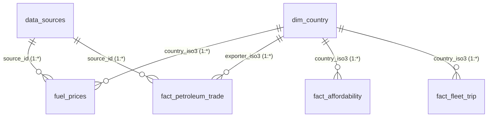

# Power BI Desktop & Service Connection Guide

This guide details how to connect **Power BI Desktop** to your MySQL `fuelx_db` database, configure the relational star-schema, and set up automated scheduled refreshes via the **Power BI On-Premises Data Gateway**.

---

## 1. Prerequisites

1. **MySQL Database:** Ensure `fuelx_db` is running on `127.0.0.1:3306` (or your remote host).
2. **MySQL Connector/NET:** Install the official Oracle MySQL Connector/NET (v8.0.32 or newer) or MySQL ODBC 8.0 Driver on your Windows machine where Power BI Desktop runs.
3. **Power BI Desktop:** Latest monthly release of Power BI Desktop.

---

## 2. Connecting Power BI to MySQL `fuelx_db`

### Step 2.1: Initiate Connection
1. Launch **Power BI Desktop**.
2. Click **Home** ➔ **Get Data** ➔ **More...** ➔ **Database** ➔ **MySQL Database** ➔ Click **Connect**.
3. In the dialog:
   - **Server:** `127.0.0.1:3306` (or remote IP / hostname)
   - **Database:** `fuelx_db`
   - **Data Connectivity mode:** Select **Import** (recommended for high-speed local in-memory DAX queries) or **DirectQuery** (for live telemetry queries).
   - Click **OK**.

### Step 2.2: Authentication
1. Select the **Database** credentials tab.
2. Enter your MySQL credentials:
   - **User name:** `root` (or configured service account)
   - **Password:** *[Your MySQL Password]*
3. Set Encryption level to **None** or **SSL** according to your server configuration.
4. Click **Connect**.

### Step 2.3: Select Tables and Views
In the **Navigator** window, check the following tables and views:
- **Dimensions:** `dim_country`, `dim_location`, `data_sources`
- **Facts:** `fuel_prices`, `fact_petroleum_trade`, `fact_affordability`, `fact_fleet_trip`, `fact_fuel_purchase`
- **Analytical Views:**
  - `vw_latest_fuel_prices`
  - `vw_top_petroleum_exporters`
  - `vw_top_petroleum_importers`
  - `vw_supplier_concentration_hhi`
- Click **Load** (or **Transform Data** to verify data types in Power Query).

---

## 3. Modeling: Star-Schema Relationships

In the **Model View**, verify the following 1-to-many (`1:*`) relationships:



- Cross-filter direction: **Single** (from dimension to fact table).
- Cardinality: **One to Many (1:*)**.

---

## 4. Date Dimension Creation (Power Query / DAX)

Create a dedicated calendar dimension table in Power BI by clicking **Modeling** ➔ **New Table**:

```dax
DimDate = 
VAR MinDate = DATE(2023, 1, 1)
VAR MaxDate = DATE(2026, 12, 31)
RETURN
ADDCOLUMNS(
    CALENDAR(MinDate, MaxDate),
    "Year", YEAR([Date]),
    "Month Number", MONTH([Date]),
    "Month Name", FORMAT([Date], "MMMM"),
    "Month Year", FORMAT([Date], "MMM yyyy"),
    "Quarter", "Q" & QUARTER([Date]),
    "Year Quarter", YEAR([Date]) & "-Q" & QUARTER([Date]),
    "Week Number", WEEKNUM([Date]),
    "Day of Week", FORMAT([Date], "dddd")
)
```

Mark `DimDate` as a date table and relate `DimDate[Date]` ➔ `fuel_prices[observation_date]`.

---

## 5. Adding DAX Measures

1. In the **Fields** pane, right-click `fuel_prices` ➔ **New Measure**.
2. Copy and paste the verified measures from `dax_measures.md`:
   - `Latest Petrol Price USD`
   - `Price WoW % Change`
   - `Total Export Volume (bpd)`
   - `HHI Concentration Score`
   - `Fuel Spend % Daily Income`
   - `Avg Fleet Cost per Litre`

---

## 6. Scheduled Refresh in Power BI Service

To keep published reports automatically updated:
1. Publish the report to your **Power BI Service Workspace**.
2. In Power BI Service, go to **Settings** ➔ **Manage Gateways**.
3. Install and register the **On-premises data gateway (Standard mode)** on the server hosting MySQL.
4. Add the `fuelx_db` data source with server `127.0.0.1:3306`, user, and password.
5. In the dataset settings, expand **Scheduled Refresh**, toggle **On**, and configure daily/weekly refresh schedules (e.g. 06:00 UTC every Monday to match weekly EIA and EC Oil Bulletin publication cycles).
